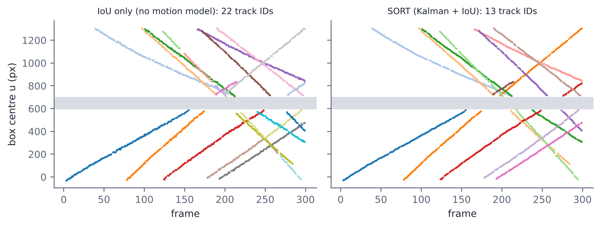
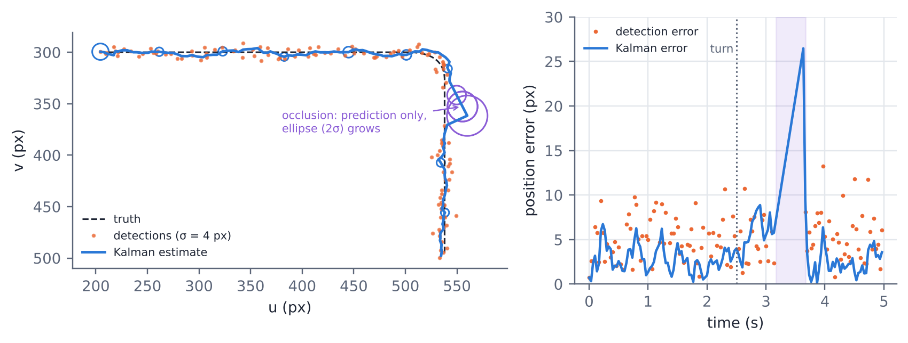

# Kalman Filter and Multi-Object Tracking

Tracking for perception: a linear Kalman filter with a constant-velocity model, and a
SORT-style multi-object tracker (Kalman prediction, IoU + Hungarian association, track
birth and death) with a ByteTrack-style second matching round for low-score detections.
Evaluated with MOTA and IDF1 on a synthetic scenario with known ground truth.
Implemented in Python (NumPy/SciPy) and C++ (Eigen), with a ROS 2 node sketch.



*Without a motion model, objects crossing behind an occluding pillar (grey band) get new IDs
(22 track IDs for 12 objects). With Kalman prediction, most tracks keep their identity (13 IDs).*

## Results

12 pedestrians crossing a 1280×720 image over 300 frames, with an occluding pillar, 3 px
detector noise, 8 % missed detections and about 1.5 false positives per frame
(`python -m examples.run_mot_demo`):

| Tracker | MOTA | IDF1 | ID switches | FP | FN |
|---|---|---|---|---|---|
| IoU only, no Kalman | 0.816 | 0.668 | 12 | 0 | 354 |
| SORT, max_age = 1 | 0.808 | 0.637 | 15 | 0 | 365 |
| SORT, min_hits = 1 | 0.795 | 0.878 | 1 | 94 | 311 |
| SORT | 0.830 | 0.894 | 1 | 0 | 337 |
| ByteTrack-like | 0.873 | 0.932 | 0 | 0 | 252 |

- The Kalman filter's prediction bridges occlusions: IDF1 0.668 → 0.894.
- `max_age` (how long a lost track survives) and `min_hits` (confirmations before a track is
  reported) trade identity stability against false positives.
- Using low-score detections for existing tracks (ByteTrack idea) recovers partly occluded
  objects: fewer misses and no ID switches.



## Repository structure

```
src/
  kalman_filter.py   KalmanFilter, constant-velocity model, 1D filter
  tracker.py         IoU, Hungarian association, Track, SORT, ByteTrackLike
  metrics.py         MOTA, IDF1, ID switches (CLEAR-MOT)
  simulation.py      synthetic MOT scenario with ground truth
examples/
  run_mot_demo.py    reproduces the results table
tests/
  test_kalman.py     unit tests (pytest)
notebooks/
  kalman_mot.ipynb   step-by-step derivation and experiments (1D KF, tuning, EKF, MOT)
cpp/                 Kalman filter with Eigen (CMake)
ros2/                ROS 2 tracker node sketch (detections in, tracks out)
```

## Run

```bash
python3 -m venv .venv && source .venv/bin/activate
pip install -r requirements.txt
pytest                              # unit tests
python -m examples.run_mot_demo     # results table
```

C++ version (needs Eigen: `sudo apt install libeigen3-dev`):

```bash
cd cpp && mkdir -p build && cd build && cmake .. && make && ./kf_demo
```

## Next steps

- Run the tracker on real detections (YOLO / Detectron2) and evaluate on MOT17.
- Camera-motion compensation for drone footage.
